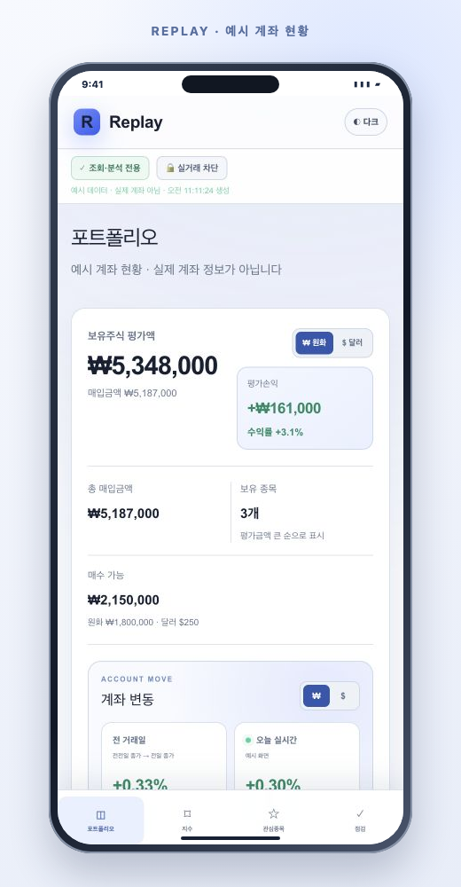
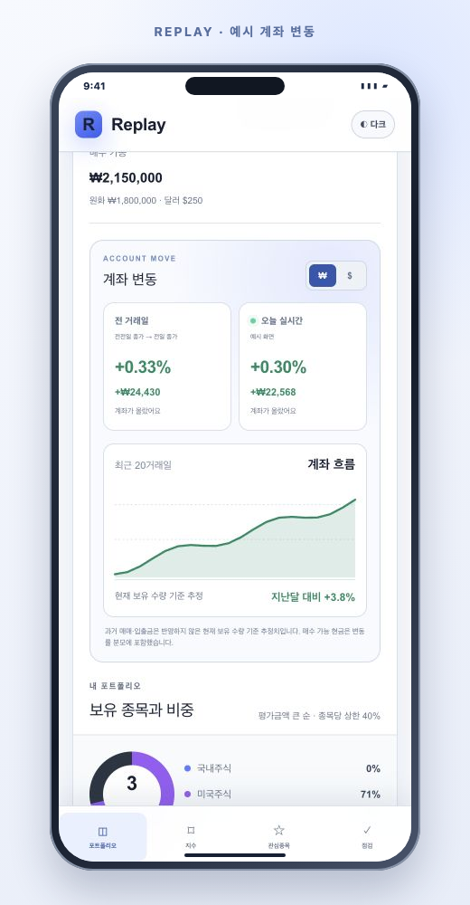
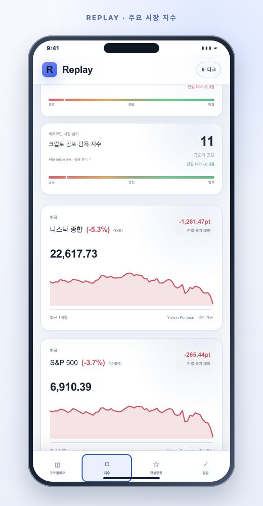
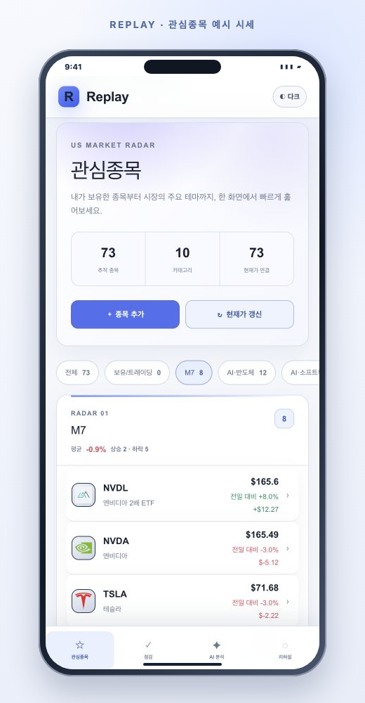
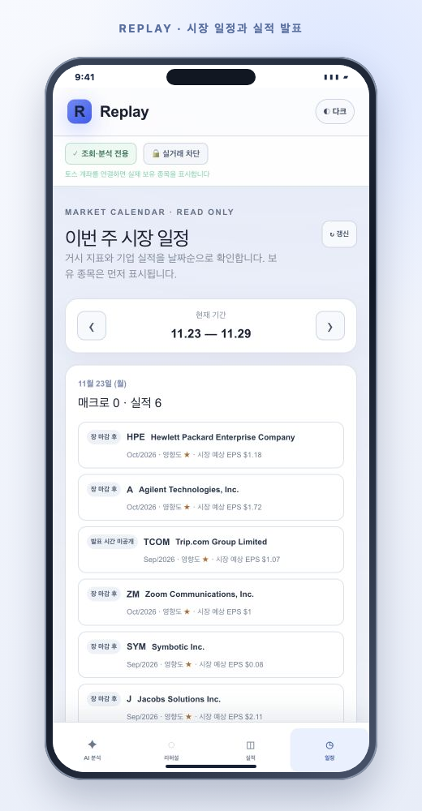
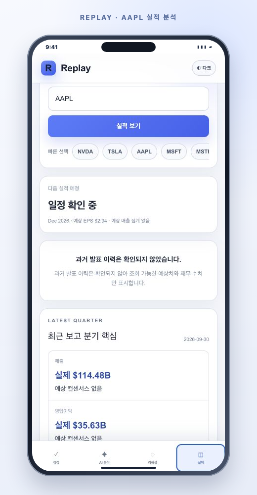
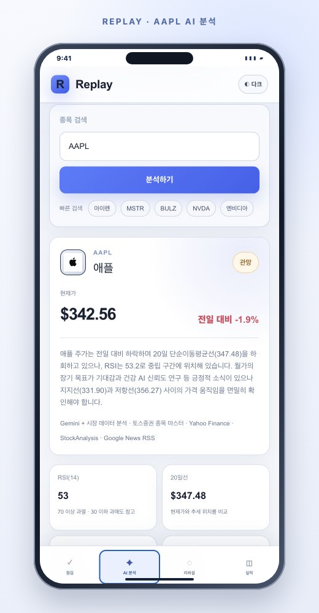

# Replay

국내·미국주식 계좌와 시장 데이터를 한곳에서 살펴보는 개인용 조회·분석 대시보드입니다.

> 개인 프로젝트입니다. 시세와 뉴스는 출처에 따라 지연·누락될 수 있으며, 화면의 분석은 투자 조언이나 수익 보장이 아닙니다.

## 화면 예시

### 계좌 현황

<p align="center">
  
  
</p>

두 화면은 로컬에서 생성한 **예시 계좌 데이터**로 촬영했습니다. 표시된 잔액, 손익, 보유 종목과 계좌 흐름은 실제 계좌 정보가 아닙니다.

### 시장 지수와 관심종목

<p align="center">
  
  
</p>

지수는 촬영 당시 조회한 시장 데이터입니다. **관심종목의 가격과 등락은 예시 시세**이며, 실제 계좌의 보유 종목은 포함하지 않았습니다.

### 시장 일정과 실적 분석

<p align="center">
  
  
</p>

2026년 11월 23일에 조회한 화면입니다. AAPL 실적 분석은 확인 가능한 다음 분기 예상 EPS와 최근 재무 수치를 보여주며, **과거 발표 이력은 제공처에서 확인되지 않아 표시하지 않았습니다.**

### AI 종목 분석

<p align="center">
  
</p>

AAPL을 입력해 조회한 결과입니다. 화면의 AI 설명과 시세·뉴스는 촬영 시점의 참고 정보입니다.

## 개발 내용

- **역할:** 개인 프로젝트로 화면과 서버 API 연동을 구현했습니다.
- **기술:** React, TypeScript, Next.js API 경로, 토스증권 Open API
- **계좌 조회:** 서버에서 토스증권 API를 호출하고, 화면에서 보유 종목과 계좌 현황을 조회할 수 있게 했습니다. 관련 코드는 [`app/api/toss`](app/api/toss)와 [`app/replay-app.tsx`](app/replay-app.tsx)에 있습니다.
- **연동 문제 해결:** 인증정보를 화면 코드에서 분리하고, 인증정보 누락과 허용 IP 문제를 구분해 확인할 수 있도록 했습니다.

계좌 조회는 각자 발급받은 API 인증정보와 허용 IP 설정이 필요합니다. 저장소만 내려받아서는 다른 사람의 계좌 데이터가 표시되지 않습니다.

## 주요 기능

- **포트폴리오와 계좌 변동:** 토스증권 Open API로 보유 종목, 수량, 평단, 평가액, 평가손익, 매수 가능 금액을 조회합니다. 전일 대비 계좌 변동과 종목별 비중도 함께 확인합니다.
- **시장 지수와 심리:** 국내·미국 주요 지수와 비트코인 등의 가격·등락·기간별 차트를 살펴보고, CNN 및 크립토 공포·탐욕 지수로 시장 분위기를 참고합니다.
- **관심종목과 관찰 후보:** 관심종목을 분류해 전일 종가 대비 움직임과 차트를 비교합니다. 기술 지표에 맞는 종목을 관찰 후보로 보여주지만, 매수 추천으로 취급하지 않습니다.
- **계좌 점검과 AI 종목 분석:** 현금 비중, 종목 집중도, 고변동성 노출, 계좌 변동을 점검합니다. 종목을 검색하면 가격·기술 구간·관련 뉴스와 AI가 정리한 대응 시나리오를 확인할 수 있습니다.
- **리스크 리허설:** 나스닥·비트코인 등 선택한 시장 지표가 지정한 폭만큼 움직였던 과거 거래일을 찾아, 선택한 종목의 당시 등락을 비교합니다. 과거 반응을 살펴보는 기능이지 미래 수익률 예측은 아닙니다.
- **실적 분석과 일정:** 예상·발표 EPS와 매출, 발표 후 주가 반응, 변동성 참고값을 확인합니다. 실적 발표와 주요 경제지표·금리 일정도 함께 살펴봅니다.

## 안전한 사용 범위

1. **조회·분석 중심:** 실제 매수·매도 주문, 모의 체결, 사용자가 직접 작성하는 투자계획 기능은 제공하지 않습니다. 리스크 리허설과 다음 주 대응 분석은 참고용 데이터 분석입니다.
2. **데이터의 한계 표시:** 시세, 실적 예상치, 일정, 뉴스와 AI 분석은 출처별 갱신 시점과 제공 범위가 다릅니다. 중요한 판단 전에는 공식 공시와 원본 데이터를 다시 확인해야 합니다.
3. **개인 정보 분리:** API 키는 로컬 `.env`에 직접 입력하며 Git에 포함하지 않습니다. GitHub에 코드를 올리는 것만으로 계좌가 연결되거나 앱 서버가 실행되지는 않습니다.

## 로컬 실행

Mac에서 Node.js 22.13 이상과 npm을 설치한 뒤, 터미널에서 저장소 폴더로 이동합니다. 아래 명령은 **처음 설치할 때** 실행하세요.

```bash
npm ci
cp .env.example .env
```

`.env`를 텍스트 편집기로 열어 본인의 `TOSSINVEST_CLIENT_ID`와 `TOSSINVEST_CLIENT_SECRET`을 직접 입력합니다. `TOSSINVEST_ACCOUNT_SEQ`는 계좌를 지정하고 싶을 때만 입력하며, 비워 두면 앱이 사용 가능한 계좌를 찾습니다. Gemini 분석을 쓰려면 `GEMINI_API_KEY`도 입력합니다. 키를 터미널 명령 인수나 채팅에 붙여 넣지 마세요. `.env`는 Git에서 제외되어 있습니다.

### 토스증권 허용 IP 등록

토스 API 키가 있어도, API 요청을 보내는 **현재 Mac의 공인 IPv4 주소**가 허용 목록에 없으면 연결되지 않습니다.

1. Mac에서 사용할 인터넷(집 Wi-Fi 또는 휴대폰 핫스팟)에 먼저 연결합니다.
2. **터미널**에서 아래 명령을 실행해 현재 공인 IPv4를 확인합니다. 화면에 숫자 형태의 IP 주소 하나가 나옵니다. 이 값은 본인이 토스증권 설정에 입력하며, 채팅에는 보내지 않아도 됩니다.

   ```bash
   curl -4 https://api.ipify.org
   ```

3. **브라우저**에서 [토스증권 WTS](https://www.tossinvest.com/)에 로그인하고 `설정 → Open API → 허용 IP 관리`로 이동해 방금 확인한 IP를 등록합니다. Open API 키 발급·이용 설정도 완료해야 합니다. 메뉴 위치는 [토스증권 공식 Open API 가이드](https://developers.tossinvest.com/docs)에서 확인할 수 있습니다.
4. 네트워크를 바꾸거나 공인 IP가 변경되면 2~3단계를 다시 진행합니다. `127.0.0.1`, `192.168.x.x`, Tailscale의 `100.x.x.x` 주소가 아니라 위 명령의 결과를 등록해야 합니다. iPhone에서 Tailscale로 화면을 열더라도 토스 API 호출은 Mac에서 나가므로 **Mac의 공인 IP**를 등록합니다.

### 앱 시작

**터미널**에서 실행합니다.

```bash
npm run dev
```

**브라우저**에서 `http://localhost:3000`을 엽니다. 앱의 `토스 조회 연결`을 눌러 실제 계좌 정보가 표시되는지 확인하세요. 개발 서버는 터미널을 닫거나 `Control+C`를 누르면 종료됩니다. GitHub에 코드를 올리는 것만으로 앱 서버가 실행되지는 않습니다.

연결되지 않으면 `.env`의 키가 입력됐는지, 현재 인터넷의 공인 IP가 토스증권에 등록됐는지 확인하세요. 이미 개발 서버가 실행 중인데 다시 실행하면 포트 충돌이 날 수 있으므로 먼저 `http://localhost:3000`을 열어보세요. 연결 점검을 위해서도 키나 `.env` 내용은 공유하지 마세요.

코드 검사는 `npm run build`, `npx tsc --noEmit`, `npm run lint`로 실행할 수 있습니다.
